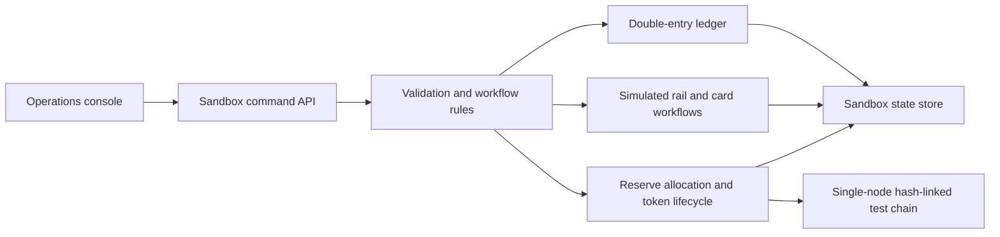

# Meridian banking sandbox

Meridian is an educational U.S. and international operations sandbox. All balances, customers, payment messages, cards, reserve confirmations, and tokens are synthetic. It does not hold deposits, connect to payment networks, issue a redeemable stablecoin, or establish regulatory approval.

## System boundary

The operations console reads a snapshot and submits commands to a single sandbox service. The service validates commands, posts balanced journal entries, updates workflow state, and records test-chain events. The local Node server persists sandbox state to a local file. A hosted deployment may use a separate persistence adapter; its advertised durability must match that adapter. There are no external payment-network credentials or production banking endpoints.

The test chain is a hash-linked event log controlled by one service. It has no independent validators, peer-to-peer consensus, economic security, public settlement, or protection against a privileged operator rewriting the entire history. It is not a deployed distributed blockchain. Its hashes support detecting accidental event changes within the simulator.

## Ledger and money

- Store amounts as integer minor units with an explicit currency. Never use floating-point arithmetic for journal amounts.
- Every journal must balance within each currency. A transfer preserves total balances; a cross-currency transaction requires an explicit FX trade and matching inventory legs.
- Distinguish posted balance, outstanding holds, and available balance. Availability must be checked inside the same serialized mutation as posting or placing a hold.
- An external payment's submission, network acceptance, settlement, return, and reconciliation are different events. A simulator's “settled” status supplies no evidence of external settlement.
- Use idempotency keys to prevent accidental repeats. A reused key with a different payload must fail rather than silently creating a different instruction.
- Corrections in a production ledger use reversal and replacement entries. Do not edit historical posted entries.

The sandbox is a simplified accounting model. Production requires a formally defined chart of accounts, debit/credit normal balances, customer liability segregation, fees and FX accounting, suspense accounts, reconciled subledgers, and independent financial control review.

## Stablecoin lifecycle and reserve separation

An arbitrary ledger credit is not a reserve. Production issuance requires verified eligible assets held under the issuer's legal reserve arrangements, with ownership, encumbrance, custody, valuation, liquidity, and redemption obligations independently established.

The sandbox should demonstrate the following separation:

1. Synthetic cash is credited and allocated from a customer's spendable funds into token backing.
2. Allocation removes the same amount from spendable fiat availability. The same dollar cannot simultaneously remain freely spendable as a deposit claim and back a token claim.
3. Minting records an equal token liability and a chain event only when allocated eligible reserves cover outstanding supply.
4. Burning extinguishes the token liability and releases the corresponding allocation according to the redemption workflow.
5. Pending redemptions remain obligations until payout is completed. A production implementation must account for in-flight mint, burn, and redemption states.

The simulator records token holdings by account, credits the source holder on mint, and requires the receiving account to own sufficient tokens before a burn releases reserves. A token transfer moves holdings without changing fiat balances or total supply. The sandbox operator can administer every account; these checks do not supply production resource-owner authentication or legal custody rights.

Required invariant: eligible, allocated, unencumbered reserve value must cover outstanding token liabilities plus any required pending obligations under the accounting policy. The console's synthetic reserve ratio is a demonstration, not an audit, attestation, proof of reserves, or evidence of solvency. Reserve coverage alone also does not establish redemption liquidity or a stable market price.

For real issuance, use an explicit state machine across ledger and chain boundaries with an outbox, unique operation IDs, confirmation/finality policy, retry and reorg handling, and reconciliation. Two independent writes to a ledger and blockchain do not form an atomic financial transaction.

## U.S. and international capability gates

| Capability | Sandbox behavior | Required before live activation |
| --- | --- | --- |
| ACH | Synthetic instructions and lifecycle | Sponsor/ODFI agreement, originator authorization, applicable Nacha Rules, account validation and fraud controls, return and exception handling |
| FedNow | Simulated instant payment | Eligible participating institution or service-provider arrangement, certification, funding/liquidity and 24/7 operations |
| SWIFT | Simulated international message/workflow | Authorized connectivity and service agreements, BIC/message requirements, correspondent arrangements, sanctions and payment transparency controls |
| SEPA/international | Explicitly simulated country/currency options | Licensed local or partner service, scheme participation/access, local customer protection, AML, privacy and data-transfer assessment |
| Cards | Synthetic card references and authorization events | Issuer/BIN sponsor and processor/network agreements, applicable PCI DSS scope, tokenization, disputes, fraud and settlement operations |
| Open banking | API/consent workflow demonstration | Jurisdiction-specific authorization, identity, security-profile conformance, consent and revocation enforcement, data minimization and liability model |
| Stablecoin | Synthetic reserve allocation and test tokens | Authorized issuer/legal model, reserve/custody arrangements, redemption rights, required disclosures, controls and independent review |

Nacha is the ACH rulemaking/scheme organization; it is not an additional settlement rail. SWIFT is primarily financial messaging; sending a message does not itself settle funds. Currency support does not confer permission to serve residents of that currency's countries.

Production feature gates must use the customer's residence, legal entity, product, currency, beneficial ownership, transaction corridor, partner permissions, and current legal assessment. Default unknown combinations to disabled. Keep policy version, decision reason, reviewer, and effective date. Country flags in this demo are not a production jurisdiction rules engine.

## Compliance and security boundary

Sandbox compliance cases illustrate review queues and decisions. They do not run authoritative identity verification, beneficial-owner verification, official sanctions screening, ongoing monitoring, transaction reporting, or legally sufficient investigations. A “clear” demo status is not a statement that a person or transaction is legally permitted.

Live controls need independent ownership and evidence: onboarding/KYC/KYB, risk assessment, sanctions and adverse-information screening, transaction monitoring, escalation, suspicious activity handling, record retention, periodic review, training, and testing. Handle reporting confidentiality and jurisdiction-specific disclosure restrictions in a separate restricted workflow.

The sandbox consent API does not implement an OAuth authorization server, FAPI certification, strong customer authentication, or third-party registration. Production must enforce scope, audience, resource ownership, consent expiry and revocation on every protected call; issuing a consent record alone provides no authorization.

## Deployment and operating constraints

Keep the hosted sandbox owner-private and use synthetic data only. Hosting access controls protect entry to a demo; they are not a substitute for application-level user identity, tenant isolation, role checks, maker/checker approvals, and operator accountability.

A local single-process service and file store cannot provide banking-grade concurrency, availability, disaster recovery, tamper resistance, or cryptographic key custody. Live operation requires a transactional datastore with isolation guarantees, append-only journal constraints, durable idempotency records, migration controls, backups with tested restoration, reconciliation, observability, incident response, and controlled deployments.

See [production readiness](PRODUCTION-READINESS.md), [threat model](THREAT-MODEL.md), and the API contract in this directory.
